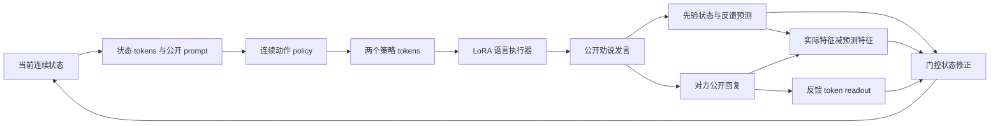

# ECLP 论文写作与实验交接清单

版本日期：2026-10-07。对象：当前 `my_eclp_final` 的 **ECLP-Offline-LPO，公开输出仅劝说语句**。本文供写作 agent 直接组织论文与实验，不代表实验已完成。代码事实以本地 `ccfa-workfiles/paper-handoff/eclp/evidence/current/` 的源码快照及其 `AUTHORITATIVE_SNAPSHOT.json` 为依据；最新结果以远程完整运行的合同、对话和逐条评估记录为依据。

## 1. 推荐的论文定位

最值得集中解决的问题是：**多轮劝说中，对方的新反馈可能推翻模型先前的判断；如何把这种“预测与实际反馈的差异”转化为下一轮可学习的策略修正？**

可以用一个直观例子说明。第一轮模型认为对方拒绝参加培训是因为价格，于是解释优惠；对方随后说“费用没有问题，我担心工作时间冲突”。下一轮应该调整对阻碍因素的表示，并围绕时间安排展开。重复优惠说明可以语言流畅，却没有利用新证据。例子是用于解释机制的构造例，不能当成已观察到的实验案例。

我们的实现先预测对方反馈的语义特征，在收到真实公开回复后，以预测误差修正连续状态，再选择连续策略。训练后半阶段只在既有训练回复上进行教师强制打分，优化潜在策略的动作分布。修正奖励比较同一策略在完整状态与屏蔽最新误差通道的状态下，对参考回复的解释能力。

推荐英文标题：**Learning to Revise Latent Strategies from Feedback for Multi-Turn Persuasion**。备选：**Evidence-Corrected Latent Policies for Multi-Turn Persuasion**。ECLP 可展开为 Evidence-Corrected Latent Persuasion，属于命名建议。正式名称应由作者统一后全篇固定。

“高斯隐式采样”“PPL 打分”“SFT 后接隐式 RL”已经出现在 LatentR3 中。它们是方法基础，不能单独作为主要创新。PPO 裁剪、LoRA、格式约束、故障恢复也属于实现选择。论文的中心应是反馈误差如何修正状态，以及离线目标如何学习使用这种修正。

### 可检验的核心假设

| ID | 假设 | 最有说服力的证据 | 反例或失败时如何解释 |
|---|---|---|---|
| H1 | 保留实际反馈的同时，显式误差通道有助于下一轮策略适配 | error-on/off重新训练，后阶段都用NLL-only；或在两个同预算SFT模型上比较 | 若无提升，不能把收益归因于误差通道 |
| H2 | 修正增益奖励比单纯参考回复 NLL 提供额外价值 | 同一 SFT 权重起点，NLL-only RL vs 完整奖励 | 若无提升，奖励创新尚未成立，不能只靠训练 reward 上升作结论 |
| H3 | 后续潜在策略优化有助于实际对话结果 | ECLP-SFT-only vs ECLP-SFT+RL，保持所有模块和推理接口一致 | 若 RL 不优于 SFT，应报告结果并重新检查代理奖励 |
| H4 | 该机制在不同基础模型上可复现 | Qwen、Llama、DeepSeek 的同协议结果 | 模型差异可描述为适用边界，不能只挑最佳模型 |
| H5 | 纯离线优化减少训练中的对话采样开销 | 训练调用数、GPU 时间、峰值显存及质量—成本对照 | 只减少调用不能证明整体训练时间更少 |

### 建议的贡献表述

1. 提出反馈预测与门控误差修正的连续状态，用公开对话证据更新多轮劝说策略。
2. 提出以固定 SFT 策略为参照的修正增益奖励，在既有回复上学习潜在策略；后半阶段无需生成新对话或调用奖励 judge。
3. 在固定无前置历史场景中，用目标接受、参考对话偏好和轮数评估效果，并用状态与奖励消融检验收益来源。第 3 条在结果完成后才可改写为实证贡献。

不宜把“首个”“显著超过所有基线”“真实心理建模”“因果说服效应”“保证 CCF A 录用”写进当前稿件。已有文献与现有数据都不足以支持这些措辞。

当前投稿判断：该机制可以形成清晰论文主题，但现有证据尚不足以判断是否达到CCF A录用水平。最关键的是证明误差通道优于同样读取反馈的替代结构，修正奖励优于单纯NLL，并排除输入信息和额外拟合造成的收益。若这三点成立，再补跨模型、评价可靠性与成本证据，论证会更完整；若不成立，应收缩贡献或改进目标，而不靠增加模块数量强化措辞。

## 2. 接近完整论文的章节组织

具体会议尚未确定，先按 NLP/对话论文组织。ACL 风格可重视任务定义、数据与评价；AAAI/IJCAI 风格可加强一般性决策机制及跨模型证据。会议级别、篇幅和当年政策在投稿前另行核实。

建议正文由摘要、引言、相关工作、方法、实验设置、结果与分析、局限及结论组成。方法和实验各占约三分之一正文；相关工作避免挤占机制解释与核心消融。附录保存完整提示词、超参数、数据构建细节及全部 judge 结果。

### 2.1 摘要

采用“任务与具体问题 → 核心机制 → 训练目标 → 验证方式 → 有证据的结果”顺序，约 180–230 个英文词，按最终会议要求调整。

中文内容草稿：

> 多轮劝说需要根据对方持续变化的反馈调整策略。仅拟合参考回复，难以区分哪些策略真正利用了对先前判断的修正。本文提出 ECLP，以反馈预测误差更新连续对话状态，并在该状态上选择潜在劝说策略。模型先通过公开回复、反馈预测及辅助策略监督联合训练，再冻结语言执行器与状态模块，在既有训练回复上优化连续动作策略。奖励结合参考回复的平均负对数似然，以及相对于固定 SFT 策略的状态修正增益。后半阶段无需生成额外对话或调用奖励评估模型。我们在固定 192 个无前置历史场景上设计跨基础模型、双评估模型的比较，并通过状态与奖励消融检验机制。[结果完成后，在此填入主要模型的配对差值、置信区间与关键消融结论。]

英文可扩展正文在 `PAPER_DRAFT_EN.md`。当前摘要的最后一句属于研究设计，不应在结果未完成时写成“experiments demonstrate”。

### 2.2 引言：按五个段落推进

| 段落 | 必须回答的问题 | 应写的内容 | 证据需求 |
|---|---|---|---|
| P1 | 多轮劝说为什么需要反馈适配？ | 目标固定，但拒绝原因与愿意接受的条件随对话揭示 | 任务文献、构造的短例子 |
| P2 | 现有路线已解决什么？ | PersuGPT 的意图—策略推理；MA2P 的显式多角色推理；连续隐式推理减少公开推理序列 | 逐篇核验原文，避免把现有方法说成完全不读反馈 |
| P3 | 本文要补哪一个机制？ | 如何学习使用“预期反馈与实际反馈不一致”的信号来修正连续状态 | 陈述设计问题；若称现有方法失效，必须有实测案例或消融 |
| P4 | 方法如何解决？ | 预测、门控误差修正、连续策略、冻结执行器的离线修正奖励 | 对应方法图与关键公式 |
| P5 | 得到了什么证据？ | 主实验、SFT-only、no-error、NLL-only、效率与 judge 校准 | 最后填真实差值，不复制历史表格 |

建议保留一句核心洞察：**A persuasion policy should learn how to revise its latent strategy when observed feedback differs from what it expected.**

不要把计算效率、心理推理、世界模型、因果效应都写成并列大问题。计算效率是离线训练的工程收益；心理状态目前没有独立心理标签验证；修正分支是模型内部干预。

### 2.3 相关工作：三个相互衔接的主题

**多轮劝说与意图—策略建模。** 介绍 DailyPersuasion 与 PersuGPT：跨领域数据、ISR 监督、基于模拟的偏好优化。介绍 MA2P：显式多角色感知与规划。先说明它们的能力，再写本文把更新过程放进可训练连续状态。

ToMAP也是必须讨论的近邻：它结合潜在反对意见和对方对counterclaims的立场建模，并用RL训练对方意识。本文应对比其结构化立场建模与我们的连续反馈误差更新；不能泛称已有方法都缺乏动态对方建模。若资源允许，可作为补充强baseline，当前不自动启动其训练。

**连续隐式推理与策略优化。** Coconut 用连续 hidden state 承载中间推理；LatentR3 将高斯潜在采样与教师强制的似然奖励用于推荐。本文借鉴连续策略与离线打分，研究多轮反馈状态修正。明确 LatentR3 是原论文框架名，`LatentRATT` 是项目中基线名称。不能把它们当两篇工作。

**离线策略学习与评价。** 将 PPO 裁剪与固定参照策略归于已有策略优化工具。本文奖励针对固定训练回复，离线目标的改进是否转化为说服效果需要独立生成实验。补充目标接受与 A/B 偏好的区别：前者判断对方是否接受明确目标，后者比较两段文本的说服质量。

LLM-as-a-Judge的已有研究指出位置、长度及自偏好等问题，可用于支持交换位置、长度诊断与人工校准的设计。不能把其他任务上的人评一致率当成当前Selene/Qwen3的可靠性结果。

目前验证的最近邻文献与 BibTeX 见 `LITERATURE_AND_EVIDENCE.md`、`references.bib`。写作 agent 应补充任务相关的反馈建模与近期连续推理工作，并逐篇检查；当前交接不包含全面的“首次提出”新颖性检索。

### 方法差异表：写相关工作时可直接参考

| 方法 | 中间表示 | 如何利用后续反馈 | 后训练反馈来源 | 本文应强调的区别 |
|---|---|---|---|---|
| PersuGPT | 显式 ISR 文本 | 从用户意图推理策略并利用模拟后续轮次 | 模拟偏好数据 / SimDPO | 本文连续状态与误差修正，以及无需新对话采样的后阶段 |
| MA2P | 显式多角色分析与规划 | 感知与世界模型等角色协作 | 原论文协议需与项目适配区分 | 本文学习连续修正通道；本地 K=0 适配没有完整记忆/检索机制 |
| Coconut | 连续 thought hidden state | 原工作研究推理过程，并非本文的多轮反馈修正 | 原论文训练方案 | 连续表示先例，不能泛称“首次隐式推理” |
| LatentR3 | 连续 reasoning/strategy 表示 | 推荐任务的上下文条件推理 | 参考答案 PPL 与潜在采样 | 本文多轮误差更新、修正通道奖励与动作密度比 |
| ECLP | 反馈修正状态 + 连续策略动作 | 预测误差与实际回复 readout 联合门控更新 | 既有回复 NLL + 相对修正增益 | 需要状态和奖励消融来建立机制贡献 |

## 3. 方法介绍：与当前实现逐项对应

### 3.1 任务与可见信息

场景背景记作 \(x\)，劝说目标为 \(g\)。第 \(t\) 轮之前的公开历史为 \(h_t=[y_1,u_1,\ldots,y_{t-1},u_{t-1}]\)，其中 \(y\) 是劝说者发言，\(u\) 是被劝说者回复。训练方法的劝说者接收 \((x,g,h_t)\)，公开只输出下一句发言。目标 judge 接收明确目标及该轮对话前缀，以判断对方当前是否接受目标。

当前修复的模拟器接收背景和已生成公开历史，不接收明确劝说目标，也不接收私有心理、策略、golden 回复或未来轮次。每个测试场景从空历史开始，保留这次生成的后续历史，完成五轮。不能将历史数据中的原对话前缀混入这些新生成场景。

### 3.2 冻结特征与连续状态

冻结基础模型、关闭 LoRA 后得到公开文本特征，再经固定随机投影及归一化。特征维度为 128。初始状态由背景 token 特征与可学习 slots 的 cross-attention 得到。状态 \(B_t\in\mathbb R^{2\times256}\) 是任务表示，不是经校准的心理信念分布。

发言后的先验与反馈预测：

\[
\bar B_{t+1}=\operatorname{LN}\{B_t+T([B_t,\operatorname{broadcast}f(y_t)])\},\quad
\hat f_{t+1}=P(\operatorname{mean}_{slots}\bar B_{t+1}).
\]

观察对方真实回复后：

\[
O_{t+1}=\operatorname{CrossAttn}(\bar B_{t+1},M(u_t)),\quad
E_{t+1}=\operatorname{broadcast}\{W_e[f(u_t)-\hat f_{t+1}]\},
\]
\[
Z_{t+1}=[\bar B_{t+1},O_{t+1},E_{t+1}],\quad
B_{t+1}=\operatorname{LN}\{\bar B_{t+1}+\sigma(G(Z_{t+1}))\odot C(Z_{t+1})\}.
\]

`no_error` 把 \(E\) 置零，但仍读取同一条实际回复并保持门控修正结构；这是最关键机制对照。`no_correction` 直接保留先验，`stateless` 用当前回复重新读取 slots。后两者回答不同问题，不可替代 `no_error`。

### 3.3 潜在策略与语言执行器

将两个状态 slots 映射成两个虚拟 token，附加到场景/历史 prompt。关闭 LoRA 的冻结基础模型对该前缀进行上下文编码；策略头读取最后两个状态 token 的 hidden states，输出 \(\mu_\phi(c_t)\in[-1,1]^{64}\)。64 维动作经可学习映射形成两个策略 token，按基础 embedding 的 RMS 归一化。带 LoRA 的语言执行器读取 prompt、状态 token、策略 token并生成下一句发言。

当前推理使用策略均值，不执行候选策略搜索；文本仍随机采样。不能称推理完全确定性，也不能画成逐 token 连续 thought 自回归链。

### 3.4 第一阶段：一轮联合监督训练

\[
\mathcal L_{SFT}=\mathcal L_{public}+1.0\mathcal L_{pred}
+0.1\mathcal L_{strategy}+0.1\mathcal L_{ISR}.
\]

`public` 为每条 session 的最后一句公开劝说回复的 token 平均 NLL；`pred` 为历史中可观察反馈的冻结特征 MSE，先按 session 求均值；`strategy` 是策略 token 表示与原策略文本特征之间的余弦对齐；`ISR` 是数据中已有私有意图/策略分析的辅助 NLL。最多 511 个目标 token 加 EOS。

公开回复与私有分析采用两条共享权重的状态路径，代码有选择性梯度隔离；观察路径预测参数、policy correction 的梯度路径应按源码描述。不能简单写成“SFT 冻结状态模块”，也不能写“完全无需显式推理监督”。我们的公开推理接口不输出分析，但 SFT 使用已有 ISR 辅助标签。

### 3.5 第二阶段：离线连续动作优化

冻结基础语言模型、LoRA、状态模块和动作到 token 的映射，仅更新策略头。每个训练上下文采样四个动作，并加入一个固定 SFT 策略的参照动作：

\[
a_i\sim\mathcal N(\mu_{old}(c),\Sigma),\quad
\Sigma=\frac{0.5^2}{64}I,\quad a_{ref}=\mu_{SFT}(c).
\]

每维标准差 0.0625。均值经过 tanh，但高斯样本不进行 clipping，否则不能继续使用当前高斯密度公式。

参考训练回复记作 \(y^*\)。同一个动作分别在事实状态和屏蔽最新反馈误差通道的状态下，用教师强制打分：

\[
\ell_f(a)=-\frac1{|y^*|}\sum_j\log p_{exec}(y_j^*\mid x,g,h,B_f,a,y_{<j}^*),\quad
d(a)=\ell_{cf}(a)-\ell_f(a),
\]
\[
R(a)=-\ell_f(a)+\lambda\tanh[d(a)-d(a_{ref})],\quad\lambda=0.1.
\]

两分支读取相同公开历史；只在最近一条已观察到的被劝说者回复处关闭误差通道，实际回复 readout 仍保留。同一个动作在两分支打分；不能分别重采样。没有历史反馈的样例仅用 NLL，修正项为零。参照动作修正 bonus 为零。

\(-\ell\) 等于负 log-PPL，能够提供每个动作的连续分数，但其意义是参考回复拟合，不是对话成功。\(d\) 是模型内部修正通道带来的拟合差值，不是对真实人的因果干预效果。修正项幅度有界，仍需检验它与真实目标接受的关系。

优势定义为 \(\Delta_i=R(a_i)-R(a_{ref})\)，用收集批次所有候选的标准差归一化，标准差下限 \(10^{-3}\)，再截断到 \([-10,10]\)。策略比率使用 **64 维联合高斯动作密度**：

\[
r_i(\phi)=\exp\{\log\pi_\phi(a_i\mid c)-\log\pi_{old}(a_i\mid c)\},
\]
\[
\mathcal L_{LPO}=-\mathbb E_i\min(r_i A_i,\operatorname{clip}(r_i,0.8,1.2)A_i)
+0.02 D_{KL}(\pi_\phi\Vert\pi_{SFT}).
\]

最新 GPU4 trainer 的硬约束是**相对当前采样 behavior policy 的每上下文 KL 不超过 0.1**；软 KL 正则参照固定 SFT policy。累计相对 SFT 的 KL 不必小于 0.1。旧总结中的“对 SFT 的硬 KL 上限”描述需要以本说明纠正。

每个收集批次 64 个上下文，四候选；policy 更新两轮、batch64、学习率 \(10^{-5}\)。越过 behavior KL 上限时回滚并将学习率减半，最多七次，下限 \(10^{-7}\)。这些规则说明稳定优化实现，不作为独立论文创新。

### 3.6 可直接放附录的算法流程

```text
输入：固定训练上下文、每个上下文的既有参考回复、SFT checkpoint
冻结：语言执行器、LoRA、反馈状态和虚拟 token 映射
固定参照：复制 SFT policy
对一个完整数据 pass 的每个上下文收集批次：
  重放同一公开历史，获得完整状态
  建立影子状态：只屏蔽最新反馈的预测误差，保留同一回复
  从当前 Gaussian policy 采样四个动作，并加入固定参照动作
  对相同动作与参考回复计算事实/影子 NLL
  计算有界修正奖励与配对优势
  以动作密度比和 soft-reference KL 更新 policy
  检查 behavior KL，越界则回滚并降低学习率
保存一个完整 pass 后最后已提交的 checkpoint
推理：用完整状态和 policy 均值生成公开劝说语句
```

后阶段新增对话生成、模拟器调用、训练奖励 judge 调用均为零。不能把 RL 过程中不存在的实时说服奖励写入论文。

## 4. 数据、输入与训练设置

### 4.1 数据划分

| 分区 | 当前数量 | 用途 | 写作注意事项 |
|---|---:|---|---|
| SFT 场景 | 10,000 | 构建监督 session | 场景数不是 session 数 |
| SFT session / 公开目标记录 | 59,868 | 每记录最后一句回复监督 | 不宣称 59,868 个独立场景 |
| 反馈预测暴露次数 | 249,720 | session 内重放反馈 | 来源前缀会在不同 session 重复，不当独立样本 |
| 偏好种子 | 2,000 | 项目重建的后阶段数据来源 | 并非新增人工标注数据 |
| 离线 RL | 1,800 | 参考回复打分及策略更新 | 有历史反馈 1,455；无反馈 345 |
| 开发集 | 200 | 代理 NLL、安全性诊断与超参数决策 | 有反馈 170；无反馈 30 |
| 原测试集 | 1,000 | 提供固定选择范围 | 当前不报告全部 1,000 条结果 |
| 固定主测试子集 | **192** | 所有主实验、judge、消融共用 | `target_turn==1` 且原始 `history==[]` |

三个基础模型的 prepared 训练文件 hash 相同。项目划分使用固定 seed 重建；原论文未提供完全相同的 split IDs/seed，因此只能称项目复现划分，不能声称逐条复现原论文测试集。正式稿必须附固定 indices/hash，检查训练、开发、测试的场景级交集以及近重复，而不只检查行号。

固定子集：`exp_code_ljj/data/test_selection_192.json` 与 `evaluation_points_from_start192.jsonl`。不能新增随机 192 条，也不能为了方便在旧 1,000 条任务上追加这些场景。

### 4.2 主实验输入合同

| 接口 | 背景 | 明确目标 | 本次已生成公开历史 | 原策略/心理标签 | Golden/未来回复 |
|---|---|---|---|---|---|
| 用户指定 Zero-shot | 是 | **否** | 是 | 否 | 否 |
| Goal-aware untuned（建议新增控制） | 是 | 是 | 是 | 否 | 否 |
| Dialogue-SFT / PersuGPT / MA2P / LatentRATT / Our | 是 | 是 | 是 | 不作为测试输入 | 否 |
| 修复后模拟被劝说者 | 是 | **否** | 是 | 否 | 否 |
| 成功 judge | 是 | 是 | 当前轮前缀 | 否 | 不需要 |
| 偏好 judge | 相同场景背景与目标语义 | 是 | 当前候选与 golden | 不向生成器传播 | 用于评价 |

**主要比较中的信息差异必须披露。** 保留用户指定的无目标 Zero-shot；为了论文机制结论，建议增加同样能看目标的未训练基础模型作为控制。若 Our 只超过无目标 Zero-shot，不能说明训练机制优于同信息的基础模型。新增控制目前是实验建议，不改动正在运行的用户 baseline。

### 4.3 当前超参数

| 项目 | 值 |
|---|---|
| 基础模型 | Qwen2.5-7B-Instruct；Meta-Llama-3.1-8B-Instruct；DeepSeek-R1-Distill-Qwen-14B |
| 精度 | BF16，不量化 |
| LoRA | rank16，alpha32，dropout0 |
| 状态 / 策略 tokens | 2 / 2 |
| 状态宽度 / 特征 / 动作维度 | 256 / 128 / 64 |
| Attention heads | 4 |
| SFT | 1 epoch，梯度累积8，7,484 个目标 optimizer steps，学习率 \(10^{-4}\) |
| SFT prompt / target 上限 | 1,536 / 512 tokens（target 包括 EOS） |
| 最新 family Our public prompt | 上限 6,144，溢出报错，完整历史不静默裁剪 |
| 冻结特征编码预算 | context1,536，response256 tokens |
| 离线 RL | 1,800 contexts，一个 pass，4候选 +1参照 |
| Teacher-forced score batch | 1 |
| Policy collection / update batch | 64 / 64，update epochs2 |
| RL learning rate / lambda / soft KL | \(10^{-5}\) /0.1 /0.02 |
| 推理 | mean latent action，文本 temperature0.95，top_p0.7，top_k50，max512 |
| 评估模型 | Selene-1-Mini-Llama-3.1-8B；Qwen3-14B，BF16 |
| 模拟器 | 项目本地 Qwen3.5-9B-persuadee merged 权重，需记录实际文件 hash |

SFT 与当前推理 prompt 预算不同，应在附录披露并检查各 actor 对公开历史的实际可见长度；不能假设所有方法看到相同长度。名义后阶段打分量约为 `1800×5 +1455×5 =16275` 个目标序列 forward，此外还有历史编码与上下文 forward。这不是实测 GPU 时间。

## 5. Baseline 介绍与公平比较

| 方法 | 论文中的介绍 | 当前项目实现 / 应核查内容 |
|---|---|---|
| Zero-shot | 未训练基础模型，仅背景/公开历史 | 用户指定不给明确 goal。输出限定为一方下一句，不能自动补策略标签 |
| Dialogue-SFT | 对话回复监督微调 | 普通回复 SFT；不是“去掉 RL 的同结构 Our” |
| PersuGPT | ISR-SFT + simulation-based DPO | 核查每个 family 的 SFT、SimDPO checkpoint、输入与公开 utterance 提取 |
| MA2P | 多角色感知、预测、决策的显式规划适配 | 当前 K=0，三个角色由同基础模型担任，没有完整原版检索/长期记忆；只能称 prompt adaptation |
| LatentRATT | LatentR3 的劝说任务适配 | 本地 README 显示 SFT/RL 均使用全部 59,868 ISR 记录；数据/预算与 Our RL1800 不同 |
| Our | 完整 ECLP 的 SFT+Offline-LPO | 包含 LoRA、状态、策略和映射；公开仅劝说语句 |
| ECLP-SFT-only（必需控制） | 同结构同监督，去掉后阶段优化 | 从完全同一 SFT checkpoint 运行，不能用 Dialogue-SFT 替代 |

主表按原生方法比较，并在附录列训练数据、更新步数、参数、推理调用数。LatentR3 另做数据/预算匹配控制，区分原生适配和公平归因实验。不同方法可以有不同内部结构，但不能把 MA2P 的多次调用与 Our 的一次调用说成相同推理预算。

历史 Qwen 表中有些方法复用旧 1,000 条中抽出的 192 对话；旧模拟器是否与新 goal-blind 模拟器等价尚未证明。因此旧 Qwen 结果只能放在协议明确的诊断表，不能与全新 Llama generation 当成同一个主实验。主稿最终表应来自相同模拟器合同、完整模型身份和固定192。

用户已取消心理/策略分析公开输出实验；正文、附录主结果、实验清单均不安排该版本。训练已有的 ISR 辅助监督仍需如实说明。

## 6. 指标与统计口径

### 6.1 Success：明确目标接受

场景成功条件：五轮中至少一轮，被劝说者明确接受同一个场景目标。询问信息、表现兴趣、愿意考虑或先试用，不自动等于购买、长期采用等更大目标。目标本身若是“尝试五分钟练习”，明确答应尝试则可成功。

成功 judge 必须引用当前被劝说者回复中的原文，输出：

```json
{"evidence":"原文短引句","progress":"accepted","success":true}
```

`success` 只允许 JSON 布尔值；`progress` 限定 `none / engagement / conditional / accepted`，且仅 `accepted` 对应 true。格式严格减少解析错误，但不能证明语义判断正确。

定义 \(S_i=\max_{t\le5}s_{it}\)，\(T_i=\min\{t:s_{it}=1\}\)，失败 \(T_i=5\)。第五轮成功与失败在平均轮数中都贡献5，因此平均轮数必须结合 Success 解读。新增分析报告第五轮仍接受比例以及“曾接受但最后撤回”的比例。

当前汇总代码：有任一已确认成功轮的场景可算成功；无成功且有 unresolved 的场景可能从 success/轮数有效分母排除。因此应保留每指标有效分母与 unresolved 数，并补充固定192分母的下界 \(confirmed/192\) 与上界 \((confirmed+uncertain)/192\)。不能暗中把解析失败全删掉或改成失败后仍称相同旧指标。

### 6.2 Win@1 与 Win-Full

Win@1 比较第一句公开劝说回复与 golden 第一条回复。Win-Full 比较本次完整五轮对话与该场景所有可用 golden 对话；golden 不一定五轮，所以不命名 Win@5。

A/B 与 B/A 评估用于控制位置偏好。将两个次序的结果映射回“生成候选相对 golden”，每次赢得1，平局0.5，输得0，再对两次求平均。最终百分比是**含平局的偏好积分**，不是纯胜出次数比例。两次交换判断不是两个独立测试场景。

同时报告纯 win/tie/loss、交换冲突率与未解析数。冲突率很高时，偏好指标应被视为不稳定测量，优先做 judge 校准。不能为提高 Our 排名，事后只修改 Our 的 judge 条件，或采用过度偏向平局的规则。

Success 与 Win 可以不同：前者看模拟对方是否接受目标，后者看相对 golden 的说服质量。分别报告；不要强行把成功率高的模型判成偏好更高。

### 6.3 置信区间与比较

以**场景**为采样单位，固定所有方法、所有 judge 在同一 original index 上配对；重采样时保留场景内五轮和两个 A/B 次序。对差值做 paired bootstrap，例如10,000次，报告95%区间。Success 的二元配对还可用 McNemar；Win 用每场景积分做配对分析。预先选定主指标和主要对照，多重比较需披露或校正。

至少主模型三个训练 seed，生成 seed 与训练 seed 分开登记；不能把 judge 顺序重复当成训练多 seed。单次192场景在50%附近的简单二项抽样区间约为±7个百分点，几分的小差值需要配对与多 seed证据。结果表中的提升用百分点 pp，不能混成相对百分比。

## 7. 最小足够的主实验包

当前训练/评估继续完成；下面新增实验是设计方案，不在本次自动启动。

| 优先级 | 实验 | 要回答的问题 | 最低完成标准 |
|---|---|---|---|
| P0 | 固定192与生成/评估合同核对 | 比较是否有效 | 全方法同 indices、空起始历史、同模拟器；checkpoint/prompt/source hashes可追溯 |
| P0 | 主模型六方法 + ECLP-SFT-only + Goal-aware untuned | 完整方案的效果与公平对照 | 双judge，完整192，不用partial补主表 |
| P0 | 训练版 no_error | 预测误差本身是否有用 | 同数据/预算独立重训；公开输入不变 |
| P0 | NLL-only offline RL | 修正奖励是否有用 | 与完整奖励完全相同 SFT起点、候选与预算 |
| P0 | matched continued-SFT / likelihood policy tuning | RL 是否只是多拟合参考回复 | 使用同1800数据，不调用模拟器，记录可训练参数差异 |
| P0 | 人工校准与 A/B 冲突审查 | 自动分数是否可信 | 盲评、统一目标定义、至少两位标注者及分歧裁决 |
| P1 | 三基础模型 | 可迁移性 | 独立完整SFT+RL，各自同协议，不拿不同模型权重替代 |
| P1 | 多seed与固定192配对置信区间 | 收益是否稳定 | 主模型3seed；保持测试集合不变 |
| P1 | 效率测量 | 离线优化是否减少成本 | 同卡记录SFT/RL分段 wall/GPU时间、峰值显存、调用与token数 |

人工校准建议采用预先固定的48个场景（按域和目标类型均衡，不按 Our 胜负选择），每方法覆盖相同场景。可加一份独立争议样本集诊断解析/goal错误；它不能替代代表性校准集。标注者看公开对话和明确目标，隐藏方法名及自动结果。报告每轮接受一致性、场景一致性、偏好一致性及分歧案例。

## 8. 消融实验：不能把推理开关当成重训证据

### 8.1 训练消融：核心表

| ID | 变体 | 需要重训什么 | 保持不变 | 对应假设 |
|---|---|---|---|---|
| A0 | 完整 ECLP-SFT+RL | 当前完整方案 | — | 参照 |
| A1 | ECLP-SFT-only | 不做RL | 完整SFT模块和推理接口 | H3 |
| A2 | no_error + NLL-only RL | SFT重训 +同预算NLL-only RL | 反馈readout、门控容量、公开history；主要与A5比较 | H1 |
| A3 | no_correction | SFT重训 +同预算RL | 输入、policy/decoder预算 | 修正总体价值 |
| A4 | stateless | SFT重训 +同预算RL | 当前反馈可读，公开history仍可读 | 潜在递归状态价值 |
| A5 | NLL-only RL | 从A0相同SFT起点重新RL | 四候选、Gaussian、KL、数据 | H2 |
| A6 | no reference centering | 重跑RL，修正bonus改为tanh(d(a)) | SFT、其他超参数 | 参照居中的作用 |
| A7 | no ISR auxiliary | 去掉0.1私有分析NLL后重训 | 公开监督、策略标签、预测监督 | 现有收益是否依赖ISR |
| A8 | no strategy alignment | 去掉0.1余弦项后重训 | 同ISR/public/pred | 策略辅助监督价值 |
| A9 | no feedback prediction loss | 去掉MSE后重训 | 保留预测头与误差结构 | 误差预测是否真的可学习 |

P0先完成 A1、A2、A5；A6–A9是针对后续结果的补充，避免先大规模网格。error-off时factual/cf相同，修正bonus退化为零。因此H1主要比较A2与A5，即两个状态版本都用NLL-only RL；H2比较A5与A0，即相同error-on SFT起点只改变奖励。A0与A2的差值同时包含状态和奖励变化，不能独自证明误差通道的贡献。另可比较两个状态版本的SFT-only结果。若展示2×2表，说明error-off的NLL/correction两格在数学上等价，无需重复训练。

### 8.2 推理干预：另列诊断表

固定完整训练权重，推理时关闭 error、冻结更新、重置 state、置零策略 tokens，观察敏感性。这能检验已训练模型依赖哪些模块，不能证明该架构比替代架构更好。前两类对照名称分别写 **retrained ablation** 与 **inference intervention**。

“Our+MA2P”若未来重启，应定义为独立混合接口实验，记录各角色是否调用完整ECLP；当前不纳入最低论文证据包，也不替代机制消融。

## 9. 其他分析实验与可视化指南

| ID / 优先级 | 分析问题 | 如何做与控制 | 表/图建议 | 原始记录 |
|---|---|---|---|---|
| X1 / P0 | 是否在后续轮次利用反馈？ | 同场景逐轮累计成功；比较A0/A1/A2/A5 | 五轮累计Success折线及配对区间；另报round1→5增益 | 每轮success、original index |
| X2 / P0 | 代理奖励是否能解释实际接受？ | dev上同上下文候选记录NLL、bonus；单独模拟其后续，不用test调权重 | reward分位数—实际接受校准图；Spearman与区间 | candidate action、NLL/bonus、后续success |
| X3 / P1 | 模型是否对更大预测误差作更大修正？ | 只统计已观察真实反馈，控制轮次/domain/回复长度；相关性不是因果 | error范数 vs state/action变化散点或分位数线 | error、gate、state shift、action shift |
| X4 / P0 | 是否只是迎合模拟器或judge？ | 双judge比较同对话；人工盲评校准；争议例单列 | 双judge场景判断2×2；agreement表；交换冲突率条图 | 原文证据、judge输出、人评 |
| X5 / P1 | 曾接受后又撤回有多少？ | 五轮全保留，不在首次成功后提前停生成 | any-round / final-round / retraction表 | 五轮goal stance |
| X6 / P1 | Win-Full低是否受golden长度影响？ | 固定按golden轮数预分组；完整比较保留，截取共同轮数仅作敏感性 | 分组Win-Full表，回复token数箱线图 | golden/generated turns与tokens |
| X7 / P1 | 不同领域与目标类型是否稳定？ | 预定义领域/行动或态度/单一或多部分目标；小样本合并并报n | domain heatmap +n；目标类型forest plot | scenario metadata |
| X8 / P1 | 是否只多写字或编造承诺？ | 统一生成上限；盲标事实支撑、承诺、重复、目标偏移与尊重选择 | quality-error表；长度—Success散点 | 公开原文、质量标签 |
| X9 / P1 | 计算收益与效果如何权衡？ | 同GPU型号、精度与完整数据预算；SFT/RL/推理分段计时 | 质量—GPU小时Pareto散点；阶段成本堆叠柱 | elapsed/GPU hours/VRAM/calls/tokens |
| X10 / P2 | lambda与采样半径如何影响？ | 仅dev选lambda如0/0.05/0.1/0.2、半径如0.25/0.5/1；预算一致 | 小型热图，最终test只评冻结选择 | dev NLL+接受与KL |
| X11 / P1 | 提升是否由额外回复拟合解释？ | 同1800上下文matched continued-SFT与policy-only likelihood控制 | 与A1/A5/A0合并归因表 | 参数、steps、tokens、proxy变化 |
| X12 / P1 | 哪些例子说明机制有效或失效？ | 预先规则选“新障碍揭示/重复拒绝/撤回”，成功与失败都给 | 两三个对话片段及gate/error注释图 | 完整public transcript、模型内部诊断 |

X2会增加模拟对话成本，优先先做dev40–80个固定上下文的低成本验证；若完全不做实际后续验证，只能报告reward与NLL/状态的关系，不能称奖励与成功相关。人工校准不能用另一个LLM冒充人工。X3可先导出数值，t-SNE/UMAP漂亮簇图不构成心理可解释性证据。

## 10. 表格与图的具体清单

### 主文建议保留的五张表

**T1 主结果。** 每个基础模型一个panel，judge分别列或分成两张；六个当前方法加两个归因控制。列：Method、N、Success↑、Win@1↑、Win-Full↑、Mean rounds↓、unresolved；附95%CI和seed数。若太宽，正文主指标与关键judge，附录完整双judge。不要只放对Our有利的judge。

**T2 核心消融。** 主模型A0/A1/A2/A5及matched continued-SFT。列与主表一致；加ΔSuccess对A0、paired95%CI。误差通道重训和推理关闭分开呈现。

**T3 方法与数据预算。** Method、公开输入、SFT场景/session数、后阶段context数、训练able参数、更新步、生成/模拟/judge调用数、策略token数。展示不同baseline适配事实。

**T4 评价可靠性。** Judge、人评样本n、goal agreement、preference agreement、A/B conflict、tie%、coverage。无法获得人评时，该列TBD，不能用格式正确率代替。

**T5 成本与稳定性。** SFT小时、后阶段小时、GPU小时、峰值VRAM、推理每轮延迟、Success及多seedSD。训练数据和硬件条件在caption写明。

### 主文建议保留的四张图

**F1 机制图。** 左：公开发言→预测反馈→真实回复→error/readout→门控状态；中：state tokens→policy→strategy tokens→LoRA decoder；右：同历史、同动作、同gold target的factual/cf打分与奖励。箭头注明谁被冻结；私有SFT ISR只在训练侧。画图不能误画成拿judge success训练。

以下是机制结构草图，供绘图agent转成正式矢量图，不是实验结果：



离线奖励图另画并行双分支：完整历史状态与屏蔽最新error的影子状态，输入同一动作与训练目标回复，输出两组NLL；加入固定SFT动作的修正差值居中。离线阶段只把优化箭头连到policy。

**F2 五轮累计接受曲线。** x=round1…5，y=固定192分母的累计接受%；A0/A1/A2/A5为主，区间按场景配对重采样。所有线使用相同轴范围与场景。

**F3 归因结果。** 左panel为SFT→NLL-only RL→完整RL的ΔSuccess及区间；右panel为训练error on/off。结果未有之前仅提供布局，不绘制假柱。

**F4 成本—质量图。** x=实测GPU小时，y=Success；每点方法/seed，marker区别基础模型，颜色区别方法。各点附同数据与硬件条件，不能把14B与7B单独耗时解释成算法差异。

附录可加F5奖励校准、F6error/修正分位数、F7领域heatmap、F8golden长度敏感性。配色用色盲友好palette，误差条单位保持一致，禁止断轴夸大小差距。导出PDF/SVG与300dpi PNG，保留绘图CSV和脚本。

### 可直接填值的主表模板

| Base model / Judge | Method | N | Success (%) ↑ | Win@1 credit (%) ↑ | Win-Full credit (%) ↑ | Mean rounds ↓ | Unresolved rounds |
|---|---|---:|---:|---:|---:|---:|---:|
| Qwen / Selene | Zero-shot (background-only) | 192 | TBD | TBD | TBD | TBD | TBD |
| Qwen / Selene | Goal-aware untuned | 192 | TBD | TBD | TBD | TBD | TBD |
| Qwen / Selene | Dialogue-SFT | 192 | TBD | TBD | TBD | TBD | TBD |
| Qwen / Selene | PersuGPT | 192 | TBD | TBD | TBD | TBD | TBD |
| Qwen / Selene | MA2P (K=0 adaptation) | 192 | TBD | TBD | TBD | TBD | TBD |
| Qwen / Selene | LatentR3 (persuasion adaptation) | 192 | TBD | TBD | TBD | TBD | TBD |
| Qwen / Selene | ECLP-SFT-only | 192 | TBD | TBD | TBD | TBD | TBD |
| Qwen / Selene | ECLP-Offline-LPO | 192 | TBD | TBD | TBD | TBD | TBD |

复制panel到Qwen3 judge、Llama及DeepSeek；只在完整相同合同结果确立后填写。N=192表示计划样本数，不代表该行已完成。

## 11. 结果段应该怎么写

主实验先写主要对照的配对差值与区间，再解释不同judge是否一致。不得写“整体最好”掩盖Win或某judge下降。如果Success升、Win-Full降，分别描述目标达成与相对golden偏好，结合长度、golden轮数和人评分析解释。

机制段先回答A2与A5，再回答A5与A0、A1与A0：在NLL-only目标下去掉误差是否下降；同一SFT起点的完整reward是否优于NLL-only；RL是否优于相同SFT。三种结果分别支撑不同结论。开发集NLL降低、训练reward上升、gate图有颜色都不能替代这些比较。

效率段先报告实测后阶段成本和新增采样为零，再做质量—成本比较。若Our总SFT更贵，应报告完整训练成本；可分别讨论后训练效率与总成本，不用一个成本数字混淆。

无提升时的写作路径：保留验证失败的实测事实，收缩“奖励促进接受”的结论；重点检查代理reward、文本长度、状态是否被decoder使用。不能重新挑测试场景、换judge、删掉强baseline或调整golden比较口径来获得理想排名。

## 12. 局限、责任与投稿前检查

实质局限包括：固定192无历史子集的覆盖有限；LLM模拟目标接受不等于真人说服；离线reward依赖参考回复质量；latent state尚未验证为心理状态；训练/推理上下文预算存在差异；golden长度与judge交换冲突会影响偏好测量；三模型结果及多seed尚未全部完成。

任务目标也需要质量审查：涉及医疗、金融或高风险选择时，不能用接受率代替事实正确性、自主选择与安全性。设计X8核查未经证实事实、虚构安排、强迫或反复施压；完整稿按所投会议要求披露数据来源、许可和可能用途。

### 写作 agent 完整交付清单

- [ ] 统一标题、ECLP展开、符号与三个贡献；核心问题保持一致。
- [ ] 摘要包含真实最终结果或明确TBD，不填想象提升。
- [ ] 引言五段连接任务、已有路线、反馈修正缺口、机制和证据。
- [ ] 相关工作每个方法引用 primary source，区别原论文与本地适配。
- [ ] 方法写清先验/预测/误差/readout/gate/策略/执行器。
- [ ] SFT四项损失、实际ISR使用、梯度隔离和训练模块如实说明。
- [ ] 离线reward、同动作双分支、无反馈退化、动作密度比与两种KL写清。
- [ ] 数据表区分场景/session/暴露次数，附固定192索引和来源hash。
- [ ] 训练/开发/测试场景交集与近重复检查有记录。
- [ ] Baseline表披露无目标Zero-shot、K=0 MA2P、LatentR3预算差异。
- [ ] Our只有完整checkpoint、公开仅劝说语句版本。
- [ ] 主结果采用同模拟器合同、完整192、双judge、有效分母。
- [ ] 核心A1/A2/A5与matched拟合控制，训练与推理消融分开。
- [ ] 至少主模型多seed、配对CI、预定义主要比较。
- [ ] 人工/自动judge校准与A/B交换冲突诊断。
- [ ] 累计接受、最终接受/撤回、golden长度及质量错误分析。
- [ ] 实测阶段耗时/显存/调用数，不把理论序列数写成耗时。
- [ ] T1–T5与F1–F4从raw记录自动生成，保留plot data和代码。
- [ ] 附录完整prompt、schema、decode、checkpoint与源码hash。
- [ ] 局限与责任部分对准实际数据与评价边界。
- [ ] 结论只重复获得证据支持的贡献，未来工作写成未来工作。
- [ ] 最终核查论文、表格、CSV、代码、运行合同的数值一致。
- [ ] 确认目标会议与当年格式、页数、匿名、引用、AI使用和数据政策。

CSV版本见 `EXPERIMENT_CHECKLIST.csv`。写作agent可复制的任务书见 `PAPER_AGENT_TASK_BRIEF_ZH.md`。当前文件是完整写作和实验设计交接，不授权自动启动所有新增消融。
